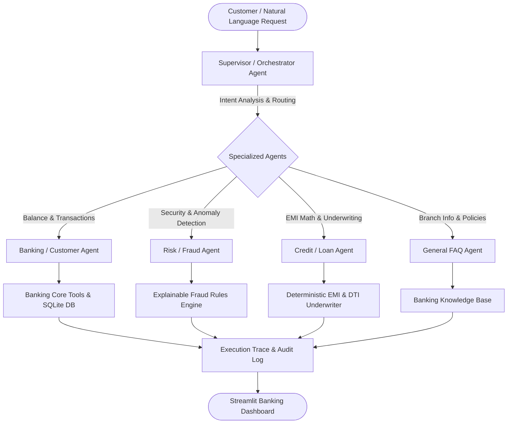

# Multi-Agent Simulated Real-Time Banking Architecture 🏦

An end-to-end, runnable Multi-Agent Banking Architecture designed for the **Wrench Wise EduTech AI/ML Internship Assignment**.

This system demonstrates how a **Supervisor Orchestrator Agent** dynamically classifies customer queries in real-time, routes tasks to specialized domain agents, executes explainable financial tools, and provides complete execution traces for auditability.

---

## 🏛️ System Architecture



### 1. Supervisor / Orchestrator Agent
- Evaluates the incoming natural language query.
- Identifies the user's intent (`CUSTOMER_BANKING`, `FRAUD_DETECTION`, `LOAN_CREDIT`, or `GENERAL_FAQ`).
- Emits an explainable routing rationale and records every step into the **Execution Trace**.

### 2. Banking / Customer Agent
- Connects to the simulated core banking database (`banking_sim.db`).
- Returns real-time account balances, account status, and transaction histories.

### 3. Risk / Fraud Agent
- Inspects transactions using multi-factor explainable rules:
  - **High-Value Spike**: Transactions exceeding threshold ($3,000) or 50% of total funds.
  - **Geo-Velocity / Location Discrepancy**: International transactions outside customer's registered home country.
  - **High-Risk Channel**: Rapid large-denomination wire transfers or foreign ATM withdrawals.
- Explains **why** each transaction was flagged.

### 4. Credit / Loan Agent
- **EMI Calculation**: Applies standard financial annuity formula:
  $$EMI = \frac{P \cdot r \cdot (1 + r)^n}{(1 + r)^n - 1}$$
- **Underwriting Assessment**: Evaluates customer's Debt-to-Income (DTI) ratio against a 45% policy limit and reviews their credit score tier (Prime, Near-Prime, Subprime).

### 5. AI Engine & Fallback Mechanism
- Integrates with local **Ollama (Qwen 2.5 3B)** for natural language interpretation and conversational phrasing.
- **Resilient Fallback Mode**: If Ollama is offline or not installed, the application falls back instantly to **100% Deterministic AI rules**. Python tools remain the single source of truth for all balances, fraud checks, and mathematical computations.

---

## 🚀 Setup & Execution Guide (Windows)

### Prerequisites
- Python 3.10+ (Tested on Python 3.13)
- Windows PowerShell or Command Prompt

### Step 1: Open the Project Directory
```powershell
cd C:\Users\anton\.gemini\antigravity\scratch\multi_agent_banking
```

### Step 2: Install Dependencies
```powershell
pip install -r requirements.txt
```

### Step 3: Run Unit & Integration Tests
Run the pytest test suite to verify all agents, fraud rules, and math formulas:
```powershell
pytest tests/ -v
```
*(All 5 test suites will pass)*

### Step 4: Launch the Streamlit Dashboard
```powershell
streamlit run app.py
```
The browser will automatically open at `http://localhost:8501`.

---

## 🤖 Optional: Running Local Ollama (Qwen 2.5 3B)

If you have Ollama installed and want to test local LLM phrasing:
1. Download Ollama from [ollama.com](https://ollama.com).
2. Pull the model:
   ```powershell
   ollama pull qwen2.5:3b
   ```
3. Run the Ollama server:
   ```powershell
   ollama serve
   ```
4. Reload the Streamlit app. The status badge will change to **Local LLM Active (qwen2.5:3b)**.
*(Note: If Ollama is not installed or turned off, the app automatically runs in Deterministic AI mode with full functionality.)*

---

## 🧪 Automated Pytest Test Suite

The test suite in `tests/test_agents.py` covers:
1. **test_banking_tools_balance_and_transactions**: Factual balance lookup and transaction history.
2. **test_fraud_detection_explainable_rules**: Multi-factor explainable rule triggering for suspicious activity.
3. **test_loan_emi_and_eligibility**: Mathematical accuracy of annuity EMI formula and DTI underwriting tiers.
4. **test_supervisor_agent_routing**: Routing accuracy across all 4 intent categories.
5. **test_execution_trace_and_fallback_resilience**: Full trace completeness and zero-downtime offline execution.

---

## 📁 Project Structure

```
multi_agent_banking/
│
├── app.py                # Streamlit interactive banking dashboard
├── agents.py             # Supervisor and specialized domain agents
├── banking_tools.py      # Core deterministic tools (balance, fraud rules, EMI)
├── database.py           # SQLite synthetic data store and seeder
├── requirements.txt      # Project dependencies
├── README.md             # Architecture, demo script, and documentation
├── .gitignore            # Git ignore file
└── tests/
    └── test_agents.py    # Pytest automated test suite
```

---

## 🎤 5-Minute Interview Demo Script

1. **Minute 1: Introduction & Architecture Overview**
   - *"Hello, this project is a Multi-Agent Banking Architecture simulating real-time retail banking operations."*
   - *"We use a Supervisor Agent that orchestrates three specialized agents: Banking, Risk/Fraud, and Credit/Loan."*
   - *"A key design principle is separation of concerns: Python tools provide factual mathematical calculations and security rules, while the AI layer handles natural language routing and conversational summarization."*

2. **Minute 2: Supervisor Routing & Balance Check**
   - Show the KPI cards for customer Alex Rivera.
   - Click **"Check Balance"** or type *"What is my current balance?"*.
   - Point out the **🔍 Orchestration Trace**: explain how the Supervisor classified the intent, routed to the Banking/Customer Agent, and retrieved the exact balance of `$14,250.75` from SQLite.

3. **Minute 3: Explainable Risk & Fraud Surveillance**
   - Click **"Audit For Fraud"** or type *"Has there been any weird activity on my card?"*.
   - Show how the **Risk/Fraud Agent** flags the $9,200 wire transfer to Ukraine and the $1,500 Lisbon ATM withdrawal.
   - Highlight the **explainability**: It doesn't just output a black-box score; it clearly explains that both the High-Value threshold and Location Mismatch rules were triggered.

4. **Minute 4: Credit & Loan Underwriting Simulator**
   - Switch to the **🧮 Loan & EMI Calculator** tab or type *"Can I get a $15,000 loan for 3 years at 9%?"*.
   - Explain the standard financial EMI formula ($477.00/mo).
   - Point out the automated underwriting decision: Alex has a 745 credit score and 6.4% DTI ratio, so the loan is **APPROVED**.

5. **Minute 5: Resilience & Fallback Demonstration**
   - Point to the AI Engine Status badge.
   - Explain: *"If Ollama with Qwen 2.5 3B is running, it phrases responses naturally. But if Ollama is offline, the system seamlessly transitions to our Deterministic AI engine without crashing or using placeholder data. All unit tests pass with zero external dependencies."*
