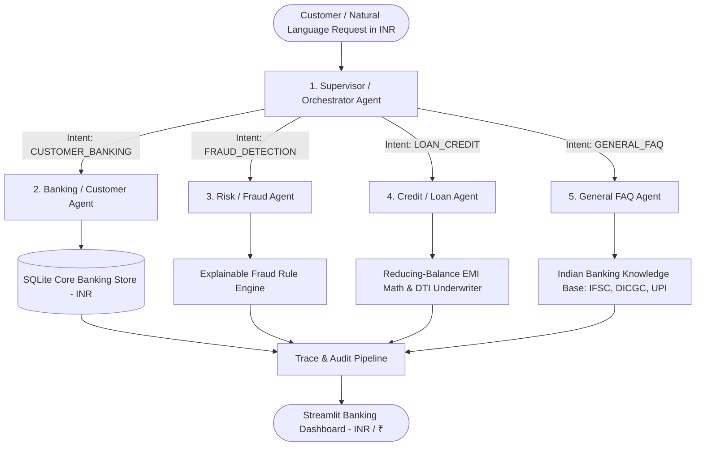

# Multi-Agent Simulated Real-Time Banking Architecture (INR / ₹) 🏦

An end-to-end, runnable Multi-Agent Banking Architecture designed for the **Wrench Wise EduTech AI/ML Internship Assignment**.

This system demonstrates how a **Supervisor Orchestrator Agent** dynamically classifies customer queries in real-time, routes tasks to specialized domain agents, executes explainable financial tools denominated in **Indian Rupees (INR / ₹)**, and provides complete execution traces for auditability.

---

## 🏛️ System Architecture



### 1. Currency & Number Formatting (INR / ₹)
- All monetary amounts are formatted according to the **Indian numbering system** (e.g., `₹1,25,000.00`, `₹4,85,250.00`, `₹18,50,000.00`).
- Terminology includes **Lakhs** and **Crores** (e.g. `₹4.85 Lakhs`, `₹18.50 Lakhs`).
- No foreign currency symbols (`$`, `USD`) appear anywhere in the application.

### 2. Supervisor / Orchestrator Agent
- Evaluates incoming natural language queries (including Indian vocabulary like *"5 lakh loan"*, *"CIBIL score"*, *"UPI"*).
- Identifies intent (`CUSTOMER_BANKING`, `FRAUD_DETECTION`, `LOAN_CREDIT`, or `GENERAL_FAQ`).
- Emits an explainable routing rationale and records every step into the **Execution Trace**.

### 3. Banking / Customer Agent
- Connects to the core banking database (`banking_sim.db`).
- Returns real-time account balances, account status, and transaction histories in INR.

### 4. Risk / Fraud Agent
- Inspects transactions against multi-factor explainable security rules:
  - **High-Value Spike**: Transactions exceeding threshold (default `₹1,50,000.00`) or 50% of total funds.
  - **Geo-Velocity / Location Discrepancy**: International transactions executed outside India.
  - **High-Risk Channel**: Large overseas wire transfers or foreign ATM withdrawals.
- Explains **why** each transaction was flagged.

### 5. Credit / Loan Agent
- **Reducing-Balance EMI Calculation**: Applies the standard financial reducing-balance formula:
  $$EMI = \frac{P \cdot r \cdot (1 + r)^n}{(1 + r)^n - 1}$$
- **Simulated Underwriting**: Evaluates customer's Fixed Obligation to Income Ratio (FOIR/DTI) against a 45% ceiling and checks CIBIL credit score tiers.
- Clearly labels all assessments as a **Simulation**.

### 6. AI Engine & Fallback Mechanism
- Integrates with local **Ollama (Qwen 2.5 3B)** for natural language phrasing.
- **Deterministic AI Fallback**: If Ollama is offline or not installed, the application automatically runs on **100% Deterministic AI rules** with zero downtime.

---

## 🚀 Setup & Execution Guide (Windows)

### Prerequisites
- Python 3.10+ (Tested on Python 3.13)
- Windows PowerShell or Command Prompt

### Step 1: Open the Project Directory
```powershell
cd C:\Users\anton\.gemini\antigravity\scratch\multi_agent_banking
```

### Step 2: Install Dependencies
```powershell
pip install -r requirements.txt
```

### Step 3: Run Unit & Integration Tests (5/5 Passing)
```powershell
python -m pytest tests/ -v
```

Output:
```text
tests/test_agents.py::test_inr_formatting PASSED                         [ 20%]
tests/test_agents.py::test_banking_tools_balance_and_transactions PASSED [ 40%]
tests/test_agents.py::test_fraud_detection_explainable_rules PASSED      [ 60%]
tests/test_agents.py::test_loan_emi_and_eligibility PASSED               [ 80%]
tests/test_agents.py::test_supervisor_agent_routing_and_indian_nlp PASSED [100%]
============================== 5 passed in 0.90s ==============================
```

### Step 4: Launch the Streamlit Dashboard
```powershell
streamlit run app.py
```
Open your browser at `http://localhost:8501`.

---

## 👥 Synthetic Indian Customers (Seed Data)

1. **Aarav Sharma (`CUST101`)**:
   - **Account**: `ACC-982104` (Savings Account)
   - **Balance**: `₹4,85,250.00` (`₹4.85 Lakhs`)
   - **Monthly Income**: `₹85,000.00` | **CIBIL Score**: 765 (Prime)
   - **Security Flags**: 2 suspicious overseas transactions (₹3,50,000 wire to Ukraine, ₹45,000 Lisbon ATM withdrawal).

2. **Priya Patel (`CUST102`)**:
   - **Account**: `ACC-441209` (Salary Account)
   - **Balance**: `₹92,400.00`
   - **Monthly Income**: `₹45,000.00` | **CIBIL Score**: 640 (Fair)
   - **Security Flags**: 1 suspicious electronics purchase in Tokyo (₹78,000.00, consuming >70% of balance).

3. **Vikram Malhotra (`CUST103`)**:
   - **Account**: `ACC-110943` (Wealth Privilege)
   - **Balance**: `₹18,50,000.00` (`₹18.50 Lakhs`)
   - **Monthly Income**: `₹2,10,000.00` | **CIBIL Score**: 790 (Prime)
   - **Security Flags**: Clean record.

---

## 📁 Project Structure

```
multi_agent_banking/
│
├── app.py                # Streamlit interactive banking dashboard (INR / ₹)
├── agents.py             # Supervisor and specialized domain agents
├── banking_tools.py      # Core deterministic tools (format_inr, fraud rules, EMI)
├── database.py           # SQLite synthetic Indian banking database
├── requirements.txt      # Project dependencies
├── README.md             # Architecture, demo script, and documentation
├── .gitignore            # Git ignore configuration
└── tests/
    └── test_agents.py    # Pytest automated test suite (INR validation)
```

---

## 🎤 5-Minute Interview Demo Script

1. **Minute 1: Introduction & Architecture Overview**
   - *"Hello, this project is a Multi-Agent Banking Architecture simulating real-time Indian retail banking operations in Indian Rupees (₹)."*
   - *"We use a Supervisor Agent that orchestrates domain agents: Banking, Risk/Fraud, and Credit/Loan."*
   - *"All financial calculations, reducing-balance EMI math, and fraud detection rules are executed deterministically in Python using the Indian numbering system (Lakhs and Crores), while the AI layer handles natural language interpretation."*

2. **Minute 2: Supervisor Routing & Balance Check**
   - Show the KPI cards for customer **Aarav Sharma** (Balance: `₹4,85,250.00`, Income: `₹85,000.00`, CIBIL: 765).
   - Click **"💰 Check Balance"** or type *"What is my account balance in Rupees?"*.
   - Point out the **🔍 Orchestration Trace**: explain how the Supervisor classified the intent as `CUSTOMER_BANKING`, routed to the Banking Agent, and retrieved the exact balance from SQLite.

3. **Minute 3: Explainable Risk & Fraud Surveillance**
   - Click **"🚨 Audit For Fraud"** or type *"Check my account for any suspicious transactions or fraud flags"*.
   - Show the flagged transactions:
     - **Apex Global Offshore Capital (`₹3,50,000.00`)**: Flagged for *High-Value Spike* (>= ₹1,50,000 threshold) and *Location Mismatch* (Kyiv, Ukraine vs registered home country India).
     - **Euronet Lisbon ATM (`₹45,000.00`)**: Flagged for *Overseas ATM withdrawal*.
   - Emphasize: *"Notice the full explainability: every flagged alert details the exact rules triggered."*

4. **Minute 4: Credit & Loan Underwriting Simulator**
   - Switch to the **🧮 Interactive Loan & EMI Calculator** tab or type *"Can I qualify for a 5 lakh personal loan for 3 years at 9.5%?"*.
   - Explain the reducing-balance EMI formula result:
     $$\text{Monthly EMI} = ₹16,016.47 \quad | \quad \text{Total Interest} = ₹76,593.10$$
   - Point out the automated underwriting decision:
     - Aarav has a 765 CIBIL score and an 18.8% FOIR/DTI ratio, so the loan is **APPROVED (Simulated)**.

5. **Minute 5: Resilience & Local LLM Integration**
   - Point to the **AI Engine Status** badge in the sidebar:
     - Explain: *"The system integrates with local Ollama Qwen 2.5 3B. However, if Ollama is offline or not installed, the application seamlessly runs on our 100% Deterministic AI fallback mode without crashing, faking execution, or inventing financial numbers. All 5 pytest suites run completely offline in under 1 second."*
